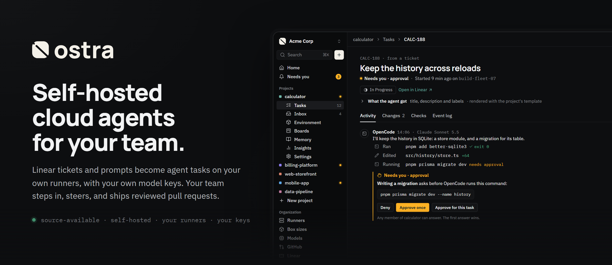
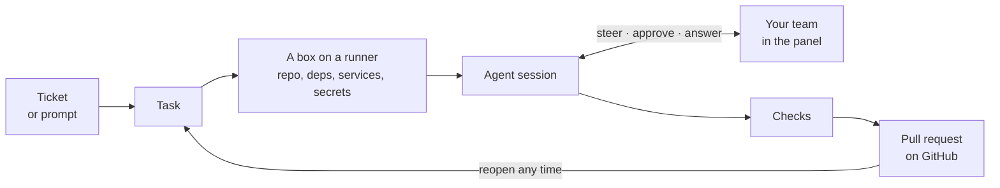
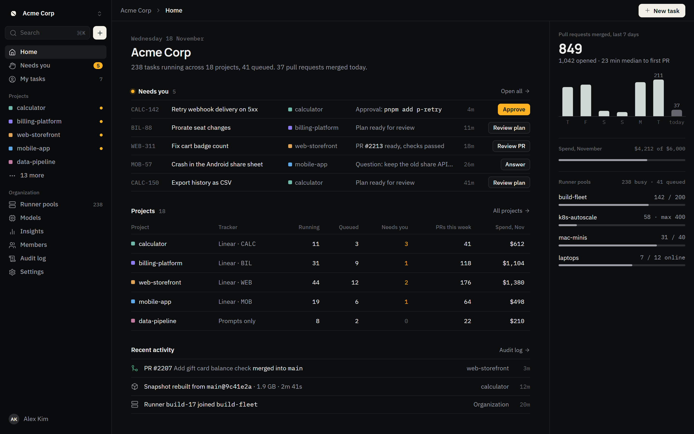
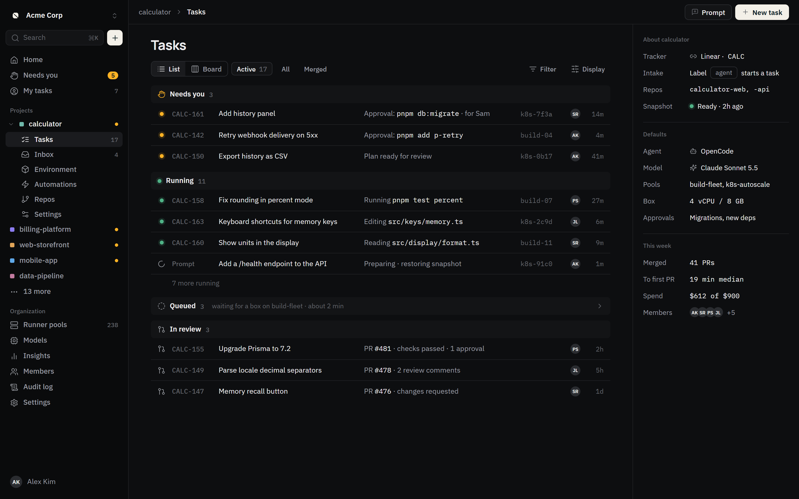
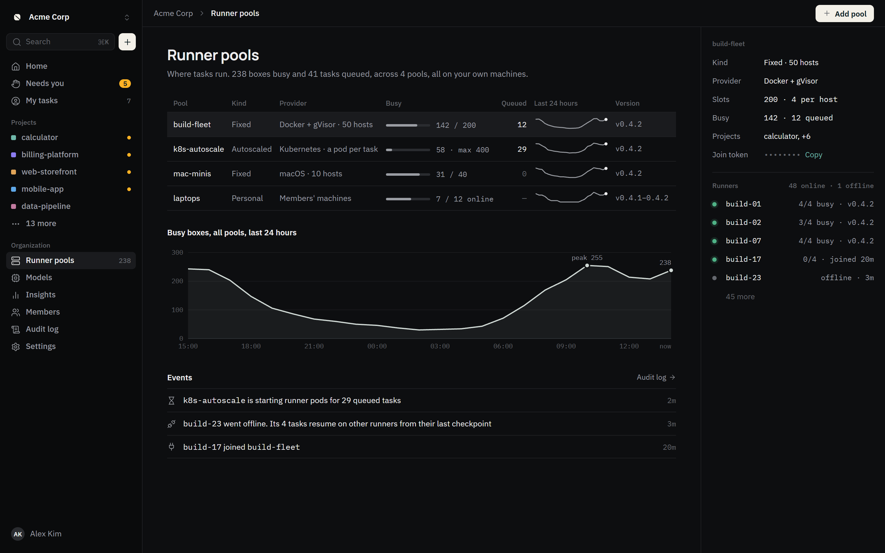

  

  <a href="#what-ostra-is">What it is</a> ·
  <a href="#how-it-works">How it works</a> ·
  <a href="#a-look-at-the-panel">The panel</a> ·
  <a href="#status">Status</a> ·
  <a href="#the-plan-lives-here">The plan</a>

> **ostra is being planned in the open.** The plan is signed off, and the first code, a set of short experiments, comes next. There's nothing to install yet. Star or watch the repo to follow along.

## What ostra is

ostra is an open-source, self-hosted control panel that turns the coding agents your team already uses into **cloud agents**.

A ticket from your tracker, or a plain prompt, becomes a **task**. An agent works on it on its own branch, in an isolated box prepared from your project's environment. Your team can watch it live, steer it, approve risky steps, and reopen it months later. It ships a GitHub pull request.

- **Your agents.** Any coding agent that speaks the [Agent Client Protocol](https://agentclientprotocol.com), starting with OpenCode and Claude Code.
- **Your machines.** Run runners wherever you like: a laptop, your servers, your Kubernetes cluster. They connect out to your ostra with a join token, and each task gets its own box.
- **Your models.** Any provider with an API base URL and a bearer token. Names, prices and logos come from [models.dev](https://models.dev).
- **Your tracker.** Linear first, then Jira. The tracker stays the source of truth.

## How it works

1. **Organize by project.** A project, such as `calculator`, links a tracker board, its repos and its **environment**: the computer every task starts from, with a setup script, services and secrets per repo.
2. **Start tasks.** Start them by hand, from a prompt, or automatically from tickets that match an intake rule.
3. **Run anywhere.** Runners dial out to the server, so they work behind NAT. Shared runner pools serve every project.
4. **Step in.** Anything that waits on a person shows as **needs you**: an approval, a question, a plan, a PR to review. One person drives a task at a time, and anyone can take over.
5. **Ship and come back.** Checks run before the PR opens. A task lives as long as its ticket does, so reopening it continues where it stopped.

The whole system on one page: [`context/architecture/system-overview.png`](context/architecture/system-overview.png).

## A look at the panel

These are design concepts built in HTML, not screenshots of shipped software.

<table>
  <tr>
    <td width="50%"> <b>Home.</b> What needs you, every project, and how busy the runners are.</td>
    <td width="50%"> <b>A project's tasks,</b> grouped by state, with what each agent is doing now.</td>
  </tr>
  <tr>
    <td width="50%"> <b>The environment:</b> repos, services, setup script, secrets per repo.</td>
    <td width="50%"> <b>Runner pools:</b> your servers, your Kubernetes cluster and members' laptops.</td>
  </tr>
</table>

## Status

| Milestone | What it delivers | |
|---|---|---|
| 0 · Spikes | Short experiments that test the plan's riskiest assumptions | **next** |
| 1 · First PR | Install, connect GitHub and Linear, and turn one ticket into one pull request | |
| 2 · Robust core | Nothing is lost: restarts, dropped runners and duplicate events are handled | |
| 3 · Step in and come back | Agent profiles, steering, approvals, plan first, reopening | |
| 4 · The team | Accounts, roles, shared runners | |
| 5 · From the tracker | Intake rules, starting tasks from Linear | |
| 6 · Launch | Docs, accessibility, signed runner downloads | |

The details, and which feature lands where, are in [`context/build-order.md`](context/build-order.md) and the feature ledger [`context/features.md`](context/features.md).

## The plan lives here

ostra is planned in this repo, in plain Markdown.

| Read | For |
|---|---|
| [`context/project.md`](context/project.md) | The brief: the problem, the core loop, the principles |
| [`context/features.md`](context/features.md) | Every feature, with its "done when" and its milestone |
| [`context/decisions/`](context/decisions/) | Architecture decisions (ADRs) and why we made them |
| [`context/domain-model.md`](context/domain-model.md) | Tasks, sessions, runners and their lifecycles |
| [`context/open-questions.md`](context/open-questions.md) | What's still undecided |
| [`context/research/`](context/research/) | Research on agents, trackers, sandboxes and similar tools, with sources |
| [`context/brand/`](context/brand/) | The brand and the panel's design |

## Built with

TypeScript end to end, strictly typed:
- **The panel:** Next.js, React, shadcn/ui and tRPC
- **Data:** Prisma on Postgres, the only database
- **Sign-in:** better-auth
- **Agents:** the Agent Client Protocol

Every integration is an adapter with a shared contract: trackers, code hosts, agents, runner providers, model providers, notifications and secret stores.

## Contributing

The project isn't taking code yet. Ideas and questions are welcome in [issues](https://github.com/JoeyKhd/ostra/issues). Contributions will use a DCO sign-off (`Signed-off-by`), not a CLA. Coding agents working in this repo follow [`AGENTS.md`](AGENTS.md).

## License

The planned licenses (ADR 0009):
- **AGPL-3.0** for the server and the web app
- **Apache-2.0** for the runner and the adapter SDK, so companies can run runners and write adapters freely

The license files arrive with the first code.
