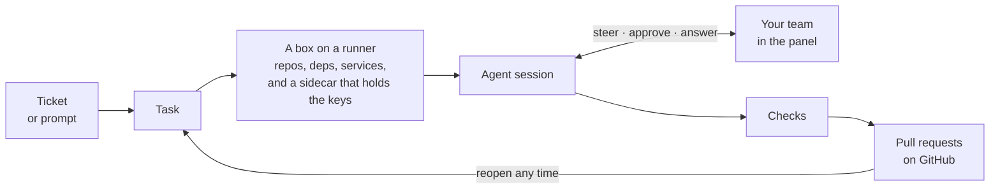
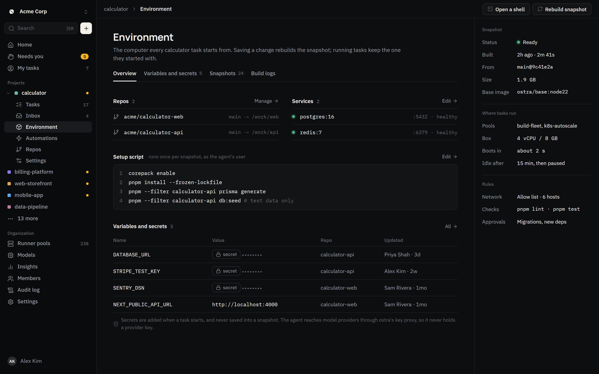

  

  <a href="#what-ostra-is">What it is</a> ·
  <a href="#how-it-works">How it works</a> ·
  <a href="#a-look-at-the-panel">The panel</a> ·
  <a href="#status">Status</a> ·
  <a href="#the-plan-lives-here">The plan</a>

> **ostra is being built in the open.** The plan was signed off on 2026-11-17 and reworked on 2026-11-18. The ten short experiments that tested its riskiest assumptions are done, and milestone 1 is under way: a typed prompt already becomes a pull request on a developer's machine. There's nothing to install yet. Star or watch the repo to follow along.

## What ostra is

ostra is a source-available, self-hosted control panel that turns the coding agents your team already uses into **cloud agents**. The code is public, and you can self-host it for your own team ([License](#license)).

A ticket from your tracker, or a plain prompt, becomes a **task**. An agent works on it on its own branch, in an isolated box prepared from your project's environment. Your team can watch it live, steer it, approve risky steps, and reopen it months later. It ships a GitHub pull request for each repo it changes.

- **Your agents.** Any coding agent that speaks the [Agent Client Protocol](https://agentclientprotocol.com): OpenCode, with more agents later through the same interface.
- **Your machines.** Run runners wherever you like: your servers, your Kubernetes cluster, a laptop. They connect out to your ostra, and on Docker and Kubernetes each task gets its own isolated box.
- **Your models.** Any provider with an API base URL and a bearer token. Names, prices and logos come from [models.dev](https://models.dev).
- **Your tracker.** Linear first, then Jira. The tracker stays the source of truth.

## How it works

1. **Organize by project.** An organization holds its members, its model providers and its runner pools. Each project in it, such as `calculator`, holds its repos, its tracker boards if it has any, and its **environment**: the computer every task starts from, with a setup script, services, and variables and secrets that each belong to one repo.
2. **Start tasks.** Start them by hand, from a prompt, or automatically from tickets that match an intake rule or a schedule. A task belongs to one project and can change several of its repos, with one pull request for each. It is a refine, code or review task.
3. **Run anywhere.** A runner dials out to the server, so it works behind NAT. Servers and clusters join a runner pool with a join token, and a pool serves every project that's allowed to use it. A laptop joins as a personal runner that runs only its owner's tasks.
4. **Keep the keys out of reach.** On Docker and Kubernetes, each task gets its own **box**: the agent's container, a **sidecar** and the environment's services. The sidecar holds the task's credentials and proxies the agent's model calls and its git. The agent only ever sees a fake key, so no model key and no GitHub token enters its container. A runner on the `host` executor, such as a laptop, has no box. It runs the task in a worktree and is labelled "not isolated".
5. **Step in.** Anything that waits on a person shows as **needs you**: an approval, a question, a plan, a PR to review. One person drives a task at a time, and anyone can take over.
6. **Ship and come back.** Checks run before a PR opens. A task is long-lived: it can be reopened months later, with or without a ticket. A box stops when it's idle, so reopening a task starts a fresh box from its saved session and branches, and continues where it stopped.

The whole system on one page: [`context/architecture/system-overview.png`](context/architecture/system-overview.png).

## A look at the panel

These are design concepts built in HTML, not screenshots of shipped software.

<table>
  <tr>
    <td width="50%"> <b>Home.</b> What needs you, every project, and how busy the runners are.</td>
    <td width="50%"> <b>A project's tasks,</b> grouped by state, with what each agent is doing now.</td>
  </tr>
  <tr>
    <td width="50%"> <b>The environment:</b> repos, services, setup script, secrets per repo.</td>
    <td width="50%"> <b>Runner pools:</b> your servers, your Kubernetes cluster and members' laptops.</td>
  </tr>
</table>

## Status

| Milestone | What it delivers | |
|---|---|---|
| 0 · Spikes | Ten short experiments that test the plan's riskiest assumptions | **done**: all ten have a finding, and the checks that need a Linux machine with Docker or a Mac are tracked in the build order |
| 1 · First PR, from a prompt | Install ostra, add a model provider and the GitHub App, create a project and type a prompt. OpenCode works in a box and opens a pull request | **in progress**: a prompt becomes a pull request through a runner on a developer's machine, and the Docker box still needs a Linux machine to test |
| 2 · Tickets in, nothing lost | A Linear ticket becomes a PR linked back on the ticket. Restarts, dropped runners and duplicate events lose nothing, and a task reopens on a fresh box a day later | specced, build started: [`context/specs/m2-tickets-in/`](context/specs/m2-tickets-in/spec.md) |
| 3 · Step in and come back | Agent profiles, steering, approvals, plan first, comments on the diff, and boxes that start from a snapshot with their services | specced: [`context/specs/m3-step-in/`](context/specs/m3-step-in/spec.md) |
| 4 · The organization | Several projects with their own access, two roles at each level, spend and budgets, and project memory | specced: [`context/specs/m4-the-organization/`](context/specs/m4-the-organization/spec.md) |
| 5 · The fleet | Runner pools on Docker hosts and Kubernetes, plus laptops, joined with a token and load-tested at 1,000 tasks at once | specced: [`context/specs/m5-the-fleet/`](context/specs/m5-the-fleet/spec.md) |
| 6 · The whole team, and autonomy | Refine, code and review tasks, intake rules and schedules, and review loops for CI and the AI review | |
| 7 · Launch | Docs, accessibility, the load test and a security review, then the public release on OpenCode. A new install goes from `docker compose up` to its first agent-made PR in under 30 minutes, following only the docs | specced: [`context/specs/m7-launch/`](context/specs/m7-launch/spec.md) |

Signed runner binaries come after v1. The details, and which feature lands where, are in [`context/build-order.md`](context/build-order.md) and the feature ledger [`context/features.md`](context/features.md).

## The plan lives here

ostra is planned in this repo, in plain Markdown.

| Read | For |
|---|---|
| [`context/project.md`](context/project.md) | The brief: the problem, the core loop, the principles |
| [`context/features.md`](context/features.md) | Every feature, with its "done when" and its milestone |
| [`context/decisions/`](context/decisions/) | Architecture decisions (ADRs) and why we made them |
| [`context/domain-model.md`](context/domain-model.md) | Organizations, projects, tasks, boxes, runners and their lifecycles |
| [`context/open-questions.md`](context/open-questions.md) | What's still undecided |
| [`context/history/`](context/history/) | The reasoning behind settled questions, such as the answers of 2026-11-18 |
| [`context/research/`](context/research/) | Research on agents, trackers, sandboxes and similar tools, with sources |
| [`context/brand/`](context/brand/) | The brand and the panel's design |

## Built with

TypeScript end to end, strictly typed:
- **The panel:** Next.js, React, shadcn/ui and tRPC
- **Data:** Prisma on Postgres, the only database
- **Sign-in:** better-auth
- **Agents:** the Agent Client Protocol

Every integration is an adapter with a shared contract: trackers, code hosts, agents, executors, model providers, notifications, secret stores and blob stores.

## Contributing

Ideas and questions are welcome in [issues](https://github.com/JoeyKhd/ostra/issues), and code in pull requests. ostra is still on its way to v1, so open an issue before a big change.

A pull request needs one tick: its author agrees to the short contributor agreement in [`CONTRIBUTING.md`](CONTRIBUTING.md). You keep your copyright, and you let the licensor license your contribution on any terms. That lets commercial licenses include contributed code.

Coding agents working in this repo follow [`AGENTS.md`](AGENTS.md).

## License

ostra is source-available, not open source. The code is public, and anyone can self-host it for their own team. Two licenses apply ([ADR 0048](context/decisions/0048-license-sustainable-use-and-apache.md)):
- **The Sustainable Use License, version 1.0**, for the server, the web app and every package that isn't Apache-2.0: [`LICENSE`](LICENSE)
- **Apache-2.0** for the runner, the protocol, the adapter SDK and the adapters, so companies can run runners and write adapters freely. Each of those packages carries its own `LICENSE`.

In short, you may self-host ostra for your own team, or use it for personal and non-commercial purposes, for free. Nobody else may sell the server or the panel, or offer them as a paid service; sharing is allowed only free of charge, for non-commercial purposes. The Apache-2.0 packages carry no such limit. ostra is an app you host yourself: there is no hosted version, and none is planned. Read the license itself for the exact terms.

A check in CI keeps an Apache-2.0 package from depending on one that isn't. The copyright holder, and the notices that go with the code, are in [`NOTICE`](NOTICE).

The copies published under AGPL-3.0 on 2026-11-18, before this change, stay AGPL-3.0 for anyone who already has them. Every version from this change on is under the terms above.
